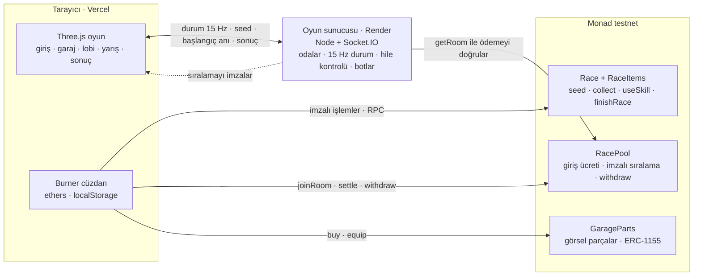

# ROADSTAR

**Monad üzerinde gerçek zamanlı roket yarışı.** Gökyüzünde kıvrılan neon bir pistte, roketli arabalarla 5 kişiye kadar yarış. Yoldaki her token, her skill ve her bitiş Monad testnet'te bir işlem.

**Canlı demo:** [roadstar-six.vercel.app](https://roadstar-six.vercel.app). Sunucu ücretsiz planda; bir süre kimse girmediyse ilk bağlantı ~1 dk sürebilir.

> **English summary.** ROADSTAR is a real-time multiplayer rocket-car racer built with Three.js, a Node/Socket.IO game server and Solidity contracts on Monad testnet. Every pickup, skill and finish is an on-chain transaction, about 45 per player per race. The game measures confirmation time live on the results screen. Players can stake an entry fee into an escrow contract that pays out from a server-signed ranking (pull payments). Cosmetic car parts are ERC-1155 NFTs.

<!-- Ekran görüntüleri: docs/screenshots/ klasörüne koy, sonra aşağıdaki satırların başındaki yorum işaretlerini kaldır -->
<!--  -->
<!--  -->
<!--  -->
<!--  -->
<!--  -->
<!--  -->

## Ne yapıyor?

- **Yarış:** 3000 metrelik pist, bitiş kapısı. Parkur (engeller, rampalar) tek bir **seed**'den üretiliyor: aynı seed herkes için birebir aynı pist.
- **Çok oyunculu:** 5 kişiye kadar oda. Sunucu herkese aynı seed'i ve aynı başlangıç anını gönderiyor (ping/pong saat eşitleme). Durumlar saniyede 15 kez gidip geliyor, rakipler ~150 ms geriden interpolasyonla çiziliyor.
- **Botlar:** Oda 20 sn'de dolmazsa boş koltuklara botlar geliyor. Botlar insanlarla aynı protokolü kullanıyor ve ücretli odada kendi cüzdanlarıyla gerçekten ödeme yapıyor.
- **Zincirde:**
  - Yarış seed'i zincirden geliyor (önceden bilinemez).
  - Toplanan tokenlar ERC-1155 olarak mint ediliyor, skill kullanılınca yakılıyor.
  - Bitiş zincire yazılıyor.
  - Fiziksel olarak imkânsız hızlar (çok erken toplama, çok erken bitiş) kontratta reddediliyor.
- **Ücretli oda:** Giriş ücreti kontratta kilitli kalıyor. Yarış bitince sunucu sıralamayı imzalıyor; 1. %80, 2. %15, %5 hazine. Herkes ödülünü kendisi çekiyor (pull). Oda dolmazsa iade var.
- **Garaj:** Boya, jant, kanat, alt neon ve itici alevi parçaları ERC-1155. **Sadece görsel**: hız ve çarpışma kutusu değişmiyor. Rakipler arabanı senin parçalarınla görüyor.
- **İki harita:** Neon Okyanus ve Satürn Yörüngesi. Satürn'de %60 yerçekimi, asteroitler, kayan yıldızlar ve meteorlar var.
- **Ses:** Web Audio ile prosedürel; hiçbir ses dosyası yok.
- **Telefon:** Dokunmatik kontroller var. Lobideki QR kodla telefondan aynı odaya katılınıyor.

## Neden Monad?

Bir yarışta bir oyuncunun gönderdiği işlemler:

| İşlem | Adet |
|---|---|
| `startRace` (seed) | 1 |
| `collect` (her token) | 40'a kadar |
| `useSkill` (kalkan, mıknatıs, rush) | birkaç |
| `finishRace` | 1 |
| Ücretli odada `createRoom` / `joinRoom` / `settle` / `withdraw` | +2–4 |

Yaklaşık 45 sn'lik bir yarışta **oyuncu başına ~45 işlem**, yani her oyuncudan saniyede yaklaşık bir işlem. 5 kişilik bir oda saniyede ~5 işlem üretiyor.

Oyun **iyimser arayüz** kullanıyor: token alınınca etki hemen oyunda uygulanıyor, işlem arkada gidiyor. Bu yaklaşım ancak onaylar oyunun ritmine yetişecek kadar hızlıysa dürüst kalır. Yavaş bir zincirde toplanan tokenlar dakikalarca "bekliyor" kalır, ekrandaki ile zincirdeki birbirini tutmazdı.

- **Ölçüyoruz:** Sonuç ekranı ve sağ üstteki işlem paneli her işlemin gönderilmesinden makbuzuna kadar geçen süreyi milisaniye olarak gösteriyor. Monad testnet'teki denemelerimizde onaylar **~0.6–3 sn** arasındaydı.
- **Nonce'u biz sayıyoruz:** İşlemleri tarayıcıda imzalayıp doğrudan RPC'ye gönderiyoruz (`eth_sendRawTransaction`). Art arda gelen işlemler RPC'yi beklemeden sırayla gidiyor.
- **Gerçek kullanım:** Testnet'teki Race kontratında bu README yazılırken **52 yarış** başlatılmıştı.

## Mimari



| Parça | Görevi | Önemli dosyalar |
|---|---|---|
| Oyun | Three.js sahne, araba fiziği, HUD, ekranlar | `src/main.js`, `src/race.js`, `src/car.js`, `src/router.js` |
| Zincir istemcisi | Burner cüzdan, nonce takibi, onay süresi ölçümü | `src/chain.js`, `src/txHud.js` |
| Çok oyunculu | Saat eşitleme, interpolasyon, lobi | `src/net.js`, `src/remotePlayers.js`, `src/lobby.js` |
| Sunucu | Odalar, hile kontrolü, ödeme doğrulama, imza, botlar | `server/index.js`, `server/pool.js`, `server/bots.js`, `server/botPilot.js` |
| Kontratlar | Yarış, tokenlar, havuz, garaj | `contracts/src/*.sol` |
| Ortak | Sunucu ve oyunun aynı okuduğu sabitler ve katalog | `shared/protocol.js`, `shared/parts.json`, `src/maps.js` |

## Kontrat adresleri (Monad testnet, chain id 10143)

| Kontrat | Adres |
|---|---|
| Race | [`0x7cBF7eAbB758CD0DBEAd1DFa9Adc8FA9A6e6f434`](https://testnet.monadexplorer.com/address/0x7cBF7eAbB758CD0DBEAd1DFa9Adc8FA9A6e6f434) |
| RaceItems (Race'in oluşturduğu) | [`0x01642877db2b43AE2395ABf2425DE304675cD672`](https://testnet.monadexplorer.com/address/0x01642877db2b43AE2395ABf2425DE304675cD672) |
| RacePool | _deploy edilince eklenecek_ |
| GarageParts | _deploy edilince eklenecek_ |

## Çalıştırma

Gerekenler: **Node 22+**. Kontratlar için [Foundry](https://getfoundry.sh).

```bash
npm install
npm --prefix server install
```

**Demo (tek komut):** Oyun sunucusu, botlar ve oyun birlikte başlıyor. Oyun aynı Wi-Fi'deki telefonlara da açılıyor; betik telefon adresini yazıyor.

```bash
npm run demo
```

**İnternet yoksa:** Zincire gitmiyor; ücretli oda kapalı, botlar ücretsiz odaları dolduruyor.

```bash
npm run demo:offline
```

Ayrı ayrı çalıştırmak istersen iki terminalde:

```bash
npm run dev
```

```bash
npm run server
```

**Kontrat testleri:**

```bash
cd contracts && forge test
```

### Ayarlar

| Dosya | Değişken | Ne işe yarar |
|---|---|---|
| `server/.env` | `RESULT_SIGNER_KEY` | Sıralamayı imzalayan anahtar (gizli) |
| `server/.env` | `POOL_ADDRESS` | RacePool adresi; boşsa sadece ücretsiz yarış |
| `server/.env` | `BOT_KEYS` | Bot cüzdanları (`node scripts/make-bots.js` üretir) |
| `server/.env` | `CLIENT_ORIGIN` | Oyunun adresi (CORS); internette Vercel adresi |
| `.env` / Vercel | `VITE_SERVER_URL` | Sunucunun adresi; boşsa sayfayı sunan bilgisayarın 3001 portu |
| `.env` / Vercel | `VITE_RACE_ADDRESS`, `VITE_POOL_ADDRESS`, `VITE_GARAGE_ADDRESS` | Kontrat adresleri |

Örnekler: `.env.example`, `server/.env.example`, `contracts/.env.example`.

### İnternete yükleme

| | Render (sunucu, Web Service) | Vercel (oyun) |
|---|---|---|
| Kök klasör | repo kökü (boş bırak) | repo kökü |
| Build | `npm install && npm --prefix server install` | `npm run build` (Vite ön ayarı) |
| Başlat / çıktı | `npm run server` | `dist` |
| Ortam değişkenleri | `RESULT_SIGNER_KEY`, `POOL_ADDRESS`, `BOT_KEYS`, `CLIENT_ORIGIN` | `VITE_SERVER_URL`, `VITE_RACE_ADDRESS`, `VITE_POOL_ADDRESS`, `VITE_GARAGE_ADDRESS` |

- Sunucu `src/` ve `shared/` klasörlerini de kullanıyor; Render'da kök klasörü `server` yapma.
- `VITE_*` değerleri derlemeye gömülüyor. Değiştirince Vercel'de yeniden deploy et.
- Render ücretsiz planı 15 dk trafik olmazsa uyuyor; ilk istek ~1 dk sürüyor. Demodan 5 dk önce sunucu adresini tarayıcıda aç, "ROADSTAR sunucusu çalışıyor" yazısını bekle.

## Kontroller

| | Klavye | Telefon |
|---|---|---|
| Gaz / fren | W / S | otomatik gaz / FREN |
| Sağa-sola | A / D | ◀ ▶ |
| Zıpla, basılı tut: süzül | Space | İTİCİ |
| Boost | Shift | BOOST |
| Takla (havada) | W S Q E | ↻ ↺ ⟲ ⟳ |
| Kalkan / mıknatıs / rush | 1 2 3 | HUD'daki kutucuğa dokun |

Hata ayıklama: **F3** kamera ve araba durumu panelini açar (telefonda adrese `?debug` ekle). Serbest kamera (**C**) sadece `?debug` adresinde çalışır.

## Güvenlik notları

- **Burner cüzdan:** Sadece testnet için. Özel anahtar tarayıcının localStorage'ında şifresiz duruyor; gerçek değeri olan para koyma.
- **Sunucu imza anahtarı:** Bilen herkes sahte sonuç imzalayıp havuzu boşaltabilir. Sadece `server/.env`'de ve barındırma panelinde dursun, repoya girmesin.
- **İmzanın kapsamı:** İmzalanan özet `chainid + kontrat adresi + oda + sıralama`. İmza başka zincirde, başka kontratta ya da başka odada tekrar kullanılamaz (replay koruması).
- **Hile kontrolü:** Sunucu, iki güncelleme arasında fiziksel olarak mümkün olandan fazla ilerlemeyi reddediyor. Kontrat da çok erken toplama ve çok erken bitişi reddediyor.
- **Bilinen sınır:** Kusursuz bir turu taklit eden bir bot, fiziksel sınırların içinde kaldığı sürece ayırt edilemez.
